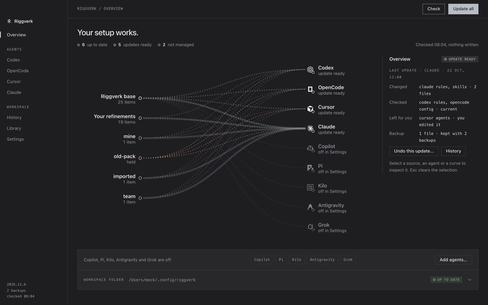

# Riggverk

Riggverk is a local agent environment manager: a Tauri control panel that installs and maintains one shared set of rules, skills, agents, and MCP entries across Codex, OpenCode, Claude Code, and Cursor, plus a lighter opt-in tier (rules, Playwright MCP entry, skills) for GitHub Copilot CLI, Pi, Kilo Code, Google Antigravity, and Grok Build (which reads Claude Code's rules file instead of its own). A desktop UI you can use with the mouse, with a keyboard shortcut for every action: a sidebar of agents, cards that say what is up to date, what can be updated and what needs your decision, and a history of every update. Every write is previewed before it happens.



The repository contains the application and its canonical bundled workspace. Installed workspaces and harness files are downstream user-owned data.

## Repository layout

- `src/` - React and Vite frontend (shell, keyboard layer, pages, Library).
- `src-tauri/` - trusted filesystem operations, native integrations, validation, backups, and Tauri commands.
- `resources/default-workspace/` - canonical bundled workspace content (the only source for installs).
- `scripts/` - repository checks, generators, contract guards, and release verification.
- `docs/` - workspace contract, security model, release and smoke checklists.

The workspace folder lives at `~/.config/riggverk` unless a custom folder saved by an earlier version is still in use or `RIGGVERK_WORKSPACE_PATH` overrides it. It is the app's data folder and holds no copy of the bundle: only the app's state (`.riggverk/`) and your personal docs (`docs/context/`). It is valid by its own state, never by bundle files in it, and the first write that needs it creates it (nothing does at launch).

## Install

Riggverk needs macOS 13.3 or later. Releases are on [GitHub Releases](https://github.com/hugrverk/riggverk/releases/latest) as a disk image and a zip of the same universal app (Apple silicon and Intel): open `Riggverk-v<version>-macOS.dmg` and drag Riggverk to Applications (or unzip `Riggverk-v<version>-macOS.zip` and move `Riggverk.app` to `/Applications`), then open it. `SHA256SUMS` lists their checksums. The app is ad hoc signed and not notarized, so macOS stops the first launch. After that first attempt, open System Settings, Privacy & Security, and choose Open Anyway next to the message about Riggverk. Riggverk replaces the app's earlier build under its previous name; moving over from it (settings and backups carry over) is described in `docs/RELEASE.md`.

## Upgrading from earlier versions

<!-- residue-allow-begin: the upgrade notes name the identifiers of earlier releases -->

Releases before the Riggverk rename used other technical names. An install made under them keeps working and is carried over without any action:

- The data folder `~/.config/agent-workspace` is read in place and nothing moves at launch. It counts as Riggverk's only when it holds a `.agent-workspace/` or `.riggverk/` state folder; a folder of that name without one belongs to another tool and is left alone (Riggverk starts fresh in `~/.config/riggverk`). The first write (an install, a saved personal doc, a kept choice) renames it to `~/.config/riggverk`. If both folders exist, `~/.config/riggverk` is used and the old one is left alone and reported in the workspace diagnostics; nothing is merged. A custom folder saved by an earlier version is never moved.
- The `.agent-workspace/` state folder inside a data folder becomes `.riggverk/` the same way (ownership records, "leave as is" and "keep mine" choices keep applying).
- Rules blocks between `AGENT-WORKSPACE BASE` markers are recognized. The next update rewrites them with `RIGGVERK BASE` markers and keeps the text outside the block byte for byte. A block you edited stays a conflict, as before.
- `AGENT_WORKSPACE_PATH` and `AGENT_WORKSPACE_BACKUP_DIR` still work as aliases of `RIGGVERK_WORKSPACE_PATH` and `RIGGVERK_BACKUP_DIR`; the new name wins when both are set.
- Rolling back a transaction made before the move maps the old folder onto the new one. It is refused, with a message, if a folder under the old name exists again next to the new one.
- Quit any older Riggverk (or the app under its earlier name) before the first launch of this version: the move is a rename, and an older app that writes during it can leave a mixed layout.
- Tools, editors and scripts of your own that mention `~/.config/agent-workspace` must be pointed at `~/.config/riggverk` after the move.
- Going back to an older version after the move is not supported: it looks for the old folder, finds none and starts as a fresh profile. To go back by hand, quit Riggverk, rename `~/.config/riggverk` to `~/.config/agent-workspace` and the `.riggverk/` folder inside it to `.agent-workspace/`; rules files that were rewritten with `RIGGVERK BASE` markers are not recognized by an older version, so restore them from the backups folder (`backups/setup/<transaction id>/`) if you need them as they were.

<!-- residue-allow-end -->

## Development

Requirements:

- Node.js 22 (the version pinned in `.github/workflows/ci.yml`; Vite 8 needs 20.19+ or 22.12+) and npm 10+
- Rust via rustup: `rust-toolchain.toml` pins 1.97.1, the version the disabled workflows also pin
- Python 3.11 or newer (the release check uses `tomllib`) and Bash for the generators, merge scripts, and release check

```bash
npm ci
npm run tauri dev     # the app
npm run dev           # browser only: Vite on :1420, no Tauri backend
npm run tauri build
```

Browser-only visual QA: open `http://localhost:1420/?mock=<scenario>` while `npm run dev` runs. `main.tsx` swaps in `src/dev/mockBackend.ts` (dev builds only). Scenarios: `default`, `conflict`, `fresh`, `error`, `empty`, `update` (app updates on, a new version on offer); `&theme=light|dark|system` sets the appearance; `&light=unserved` leaves Copilot and Pi without a skills folder (turn them on in Settings first).

Release verification:

```bash
./scripts/release-check.sh
```

Do not claim a release check passed unless it was run and completed successfully. See `docs/RELEASE.md`. Recipes for changing skills, agents, rules, harnesses and bundled files, and what each gate step guards: [docs/MAINTAINING.md](./docs/MAINTAINING.md).

Releases are cut locally: `./scripts/release.sh prepare` (CalVer version, notes draft, release PR) and `./scripts/release.sh publish` (build, ad hoc sign, zip, GitHub release). See `docs/RELEASE.md`.

## Workspace ownership

1. The source repository.
2. Bundled defaults under `resources/default-workspace/` (packaged read-only with the app).
3. The user-owned data folder (app state and personal docs; no copy of the bundle).
4. Harness-native files under each tool's documented home directory.

**Install or Update** is the one write workflow: **Update all** in the top bar (or `u` on the Overview) for everything, or **Update** (`u`) on an agent page for that agent. The app computes a plan, shows every create, update, remove, and conflict row, and writes nothing until you press **Apply** (`y`); Enter never applies. **Preview** (`p`) has no apply path; **Cancel** (`n`) or Escape cancels. A backup and a rollback-capable transaction are recorded before the first write; **Undo last update…** (`z`, or `:rollback`) restores the last transaction after a dry run and a confirm, and History offers the same for the newest completed update.

Every harness file is installed from the packaged bundle, and the Library and health checks read it too. The app keeps no copy of the bundle in the data folder: the Workspace folder cell on the Overview reads **Up to date**, or `N old copies to remove` while copies from earlier releases remain. Those are removed only through the reviewed update of the workspace folder (Update all or `:update workspace`, then `y`; one transaction with backups; `z` restores them), and only when their bytes prove they are the app's. An edited copy, or any file not provably the app's, is left in place and listed as a manual step, never a conflict. Your notes, `.riggverk/` and `docs/context/` are never touched. See `docs/WORKSPACE_CONTRACT.md` for the contract.

## Skills

The bundled catalog is listed in [SKILLS.md](resources/default-workspace/docs/SKILLS.md). `retro` is user-invoked only, and `adversarial-implementation`, `adversarial-review` and `adversarial-test` run only when you ask for them (they are not in the routing rules).

```text
skills/<skill>/SKILL.md
skills/<group>/<skill>/SKILL.md
```

One optional group level is supported; deeper nesting is invalid. Every harness installs the canonical `SKILL.md` byte for byte; there are no generated per-harness copies. Text meant for one harness sits at the end of the file under `## Harness notes` (`### Claude Code`, `### Codex`, `### OpenCode`, `### Cursor`, `### Light harnesses`), and `python3 scripts/check-skill-routing.py` validates the structure.

Installed layout is flat and holds the whole skill directory: `<skills-folder>/<skill-name>/SKILL.md` plus the skill's supporting files at their relative paths. Skills are one surface for all harnesses and are installed into the folders the enabled harnesses read: Claude Code `~/.claude/skills`, Codex `~/.agents/skills` (`$CODEX_HOME/skills` with a customized `CODEX_HOME`), and `~/.agents/skills` for OpenCode, Cursor, Kilo or Grok when neither of those is wanted already. Copilot and Pi read `~/.agents/skills` and no other shared folder, so enabling either adds it; Kilo and Grok read both shared folders. With Codex enabled and a customized `CODEX_HOME` the isolation wins: Copilot and Pi are then reported as unserved and nothing is installed for them. Google Antigravity reads neither shared folder, so while it is enabled its own two folders are filled as well: `~/.gemini/config/skills` (App and IDE) and `~/.gemini/antigravity-cli/skills` (CLI); switching it off removes the app's copies there through the same reviewed plan. The app's copies from older versions in `~/.config/opencode/skills`, `~/.cursor/skills` and `$CODEX_HOME/skills` are removed on update; an edited copy stays.

An edited skill or agent file is a conflict Install leaves alone. Resolve it from the harness page: `d` shows the diff against the bundled file, `b` replaces your file by the bundled one after a review (`y` applies, `n` cancels; your file is backed up first and `z` rolls it back), `m` keeps your version (recorded in `.riggverk/kept-files.json`; the app never writes the file and says when a bundled update is waiting) or hands it back, `c` marks the next one, and `:resolve diff|bundled|mine|manage` does the same by name.

All skills support the central harnesses and the light tier. The skills surface is not gated by target toggles. Deprecated Riggverk skills are matched against bundled reference snapshots: identical managed copies are removed after backup, diverged and unknown copies are preserved.

## Rules

Rules files are merge-managed. Install writes the shared base (`templates/global-agent-rules.md` plus a harness appendix, composed under `templates/sync/`) between `BEGIN RIGGVERK BASE` and `END RIGGVERK BASE` markers; everything outside the markers is yours and is kept byte-for-byte. Add refinements below the block; they override the base.

Targets: Codex `$CODEX_HOME/AGENTS.md` (default `~/.codex/AGENTS.md`), OpenCode `$XDG_CONFIG_HOME/opencode/AGENTS.md` (default `~/.config/opencode/AGENTS.md`), Claude Code `~/.claude/CLAUDE.md`, and for the light tier GitHub Copilot `~/.copilot/copilot-instructions.md`, Pi `~/.pi/agent/AGENTS.md`, Kilo Code `$XDG_CONFIG_HOME/kilo/AGENTS.md` (default `~/.config/kilo/AGENTS.md`) and Google Antigravity `~/.gemini/AGENTS.md` (at most 24,000 bytes, which the app never passes; `~/.gemini/GEMINI.md` is not touched). Grok Build has no rules file of its own: it reads Claude Code's `~/.claude/CLAUDE.md`, so its page shows the rules as `shared` while Claude Code's rules are installed and `none` otherwise. Cursor User Rules stay a manual copy of `templates/cursor/user-rules.md`.

An edited block or a pre-existing file without markers is a conflict: Install leaves it alone. Resolve it with a diff, **Convert** (current base becomes the managed block, your changed sections move below it; previewed and backed up), or **Leave as is**. Harness pages expose these as `d` diff, `v` convert, `m` leave as is, and `:rules`. Details and the full plan table are in `docs/WORKSPACE_CONTRACT.md`.

## MCP

OpenCode and Cursor get the named Playwright MCP entry (see their rows under Harness ownership). The light tier gets one `playwright` entry in the MCP file its harness reads: GitHub Copilot `~/.copilot/mcp-config.json` (key `mcpServers`; the CLI and VS Code both read it), Pi `~/.pi/agent/mcp.json` (`mcpServers`) and Kilo Code `kilo.jsonc` (else an existing `kilo.json`) in `$XDG_CONFIG_HOME/kilo` (default `~/.config/kilo`; key `mcp`). Google Antigravity gets it in `~/.gemini/config/mcp_config.json` (`mcpServers`). The target `kilo_mcp` is off by default because that file is Kilo's main config and may hold provider keys; `antigravity_mcp` is off by default too. Grok Build gets it as the `[mcp_servers.playwright]` table in `~/.grok/config.toml`, edited in place with every other byte kept; the target `grok_mcp` is off by default because that file may hold `api_key`.

The entry runs `npx --prefix <npx-prefix> -y @playwright/mcp@0.0.83 --browser chrome --isolated --no-webmcp` with the shared browser cache in `PLAYWRIGHT_BROWSERS_PATH`: the system Google Chrome in a profile kept in memory (no Playwright Chromium download), and no tools registered by a page (WebMCP, on by default in Playwright MCP since 0.0.81). It starts npx through `/bin/sh` from `<playwright-output>`, an owner-only `playwright-output` folder in the app data folder, and `<npx-prefix>` is an empty, owner-only `npx-prefix` folder next to it. So npx never uses the `.npmrc`, the `node_modules` or the `node_modules/.bin` (a `sh` or `node` there included) of the repository the agent runs in, any of which could run code as the server starts. A client that sends no MCP roots gets `playwright-output` as the server's working folder, so screenshots and other files the server saves land there, not in your project. The OpenCode and Cursor entries pass the same three flags after `--config ~/.config/playwright-mcp/config.json`; the light entries do not use that sidecar, so they work whichever targets are on. Pi does not declare the tools of an MCP server to the model by default (`exposure` `codemode`); the entry leaves that choice to you, and the Pi page says so.

Only that entry is written. The file is read and written as strict JSON: your other servers keep their values and their order, and a file with comments, a trailing comma or a byte order mark is refused with zero mutation and a plain reason (it never quotes the file). An entry named `playwright` that is not the managed one is yours and is left as is. A new file is owner-only. Uninstall never deletes an MCP file. Details are in `docs/WORKSPACE_CONTRACT.md` and `docs/SECURITY_MODEL.md`.

## Agents

Shared semantic bodies live under `agent-specs/`; `scripts/generate-agent-adapters.py` composes the harness-native adapters. See [Agents](docs/WORKSPACE_CONTRACT.md#agents) for the names provided for each harness:

- OpenCode: Markdown agents under `agents/` (`architect` is the primary agent). `inspector` and `verifier` can be run directly with `@`; the other subagents are hidden from `@` and reached through delegation.
- Claude Code: subagents under `templates/claude/agents/`. Each pins a model in its `*.header.yaml` (`haiku` for `repo-scout`, `sonnet` for the others), so the read-only helpers stay cheap and behave the same whatever model the main session runs. To change one, edit its `model:` (`inherit` uses the session's model) and regenerate the adapters.
- Codex: TOML agents under `templates/codex/agents/`.
- Cursor: agents under `templates/cursor/agents/`.

Generated adapters must stay current with their sources; repository checks fail on drift.

## Harness ownership

- **OpenCode**: composed rules, native agents, skills, managed config keys (including `lsp: true` for the built-in language servers), `tui.json`, and the named Playwright MCP entry. User provider blocks, unrelated MCP entries, and unknown keys are preserved. A value you set yourself for one of the managed keys is replaced: the review lists each such key with its value now and the one it becomes, the previous file is kept in the install's backup, and Uninstall leaves the merged file in place. The supported runtime is **OpenCode 1.x** (npm `opencode-ai` or `anomalyco/tap/opencode`); Homebrew core's `opencode` installs 2.x, which is detected and flagged but not supported, and the app keeps writing the 1.x config format. Details and the LSP opt-outs are in `resources/default-workspace/docs/OPENCODE_CONFIG.md`.
- **Codex**: rules, TOML agents, skills, and allowlisted config defaults in `$CODEX_HOME/config.toml` (default `~/.codex/config.toml`). `approval_policy`, `approvals_reviewer`, `sandbox_mode`, and `apps._default.*` follow the template; the Codex page shows a key that differs as a decision: **Keep mine** (`m`, asks first) keeps your value (recorded in `.riggverk/config-preferences.json`; the other keys keep following the template, and **Hand back** returns it), and **Use Riggverk defaults** (`b`) previews the exact key changes, then `y` writes only the keys that differ, with a backup. `model` and `model_reasoning_effort` are yours: never written, overwritten, or reported as drift. Riggverk sets no model; your agent's own default applies. The `codex_config` target is off by default; the posture check reads named keys of `config.toml` whatever the target says, in memory only. A non-empty `AGENTS.override.md` makes Codex ignore `AGENTS.md`; Codex health warns about it. Legacy app-shaped profile selectors and tables are removed during migration only. Skills install to `~/.agents/skills` (`$CODEX_HOME/skills` with a customized `CODEX_HOME`); the app's older copies in `$CODEX_HOME/skills` are removed on update, and diverged copies stay.
- **Claude Code**: rules, subagents, and skills. With the `claude_config` target on (off by default), Install also sets `attribution.commit` and `attribution.pr` to `""` in `~/.claude/settings.json`, which hides Claude Code's `Co-Authored-By` commit trailer and its "Generated with Claude Code" pull request line; every other key of the file keeps its value and its place. For the setting, the file is read as strict JSON only while the target is on: a file with comments or a trailing comma is refused unchanged, and attribution you set yourself (custom text, `attribution: false`, `includeCoAuthoredBy`, or `""` that Riggverk did not write) is left as it is. The setting is not applied while `CLAUDE_CONFIG_DIR` is set, and a project's `.claude/settings.json` or managed settings can still override it. Claude health never reads the file. Authentication, trust state, caches, and user-scoped MCP credentials stay Claude-managed and are not read or written. The posture check reads named keys of `~/.claude/settings.json` in memory only, whatever the target says (see Security posture check in `docs/WORKSPACE_CONTRACT.md`).
- **Cursor**: global agents, skills, and the named Playwright MCP entry in `~/.cursor/mcp.json`, via native Rust operations. User Rules and Auto Review stay manual; the posture check reads two keys of `~/.cursor/sandbox.json`, in memory only. Project `.cursor/*`, project agents, project MCP, `.cursorignore`, and `AGENTS.md` are never written.
- **GitHub Copilot, Pi, Kilo Code** (the light tier, off by default): the rules block in the file listed under Rules, the Playwright MCP entry in the file listed under MCP, and skills in the shared folders above. Nothing else in `~/.copilot`, `~/.pi` or `~/.config/kilo` is written; the posture check reads the `permission` key of Kilo's config file in memory only, and nothing of Copilot or Pi. Pi reads one context file per folder: a plan refuses while `AGENTS.override.md` masks the file, or when it would create `AGENTS.md` beside a `CLAUDE.md` (Pi would stop reading that one). Kilo loads one global rules file, so creating its file stops Kilo reading `~/.claude/CLAUDE.md`; the review and the page say so. Their pages show the CLI version, the rules file, the Playwright MCP entry and whether the bundled skills are installed where each one reads. The only call made to these CLIs is `<cli> --version` (bounded, parse-only). None of them is on a Finder-launched app's `PATH` when installed through nvm, so the highest version folder of `~/.nvm/versions/node` that has the CLI is used; a CLI installed anywhere else is reported as not on `PATH`, and the app has to be started from a shell where it runs. Checked against Copilot CLI 1.0.98, Pi 1.3.0 and Kilo 7.8.12. `COPILOT_HOME` and `PI_CODING_AGENT_DIR` are not followed; `XDG_CONFIG_HOME` is, for Kilo.
- **Google Antigravity** (light tier, off by default; CLI `agy`): the rules block in `~/.gemini/AGENTS.md`, the Playwright entry in `~/.gemini/config/mcp_config.json` (target off by default) and skills in its own `~/.gemini/config/skills` and `~/.gemini/antigravity-cli/skills`. Nothing else in `~/.gemini` is written or read. Its paths follow Antigravity's documentation and were not checked against a local install.
- **Grok Build** (light tier, off by default; CLI `grok`): no rules file of its own (it reads Claude Code's), the Playwright entry in `~/.grok/config.toml` (target off by default) and skills in the shared folders above. Nothing else in `~/.grok` is written or read, and `GROK_HOME` is not followed: the app writes the default location and the page warns while it is set. Its paths follow Grok's documentation and were not checked against a local install.

## Application surfaces

The sidebar lists Overview, the enabled agents, History, Library and Settings. The digit keys are fixed and do not move when an agent is turned off: `1` Overview, `2`-`5` Codex, OpenCode, Cursor and Claude, `6` History, `7` Library, `8` Settings. Copilot, Pi, Kilo, Antigravity and Grok appear after Claude once enabled in Settings and have no digit (open them from the sidebar or with `:copilot`, `:pi`, `:kilo`, `:antigravity`, `:grok`); `Mod+,` and `:settings` open Settings. `?` lists every key, command and state; `:` or `Mod+k` opens the command line. Tab moves through the sidebar, the top bar and then the page, with a visible focus ring.

The top bar has **Check** (reads the installed state again, writes nothing) and **Update all** (reviews everything that can be updated). Every state is said in words: **Up to date**, **Update ready**, **Needs your decision**, **Yours**, **Fix by hand**, **Not managed**.

- Overview - a one-sentence headline and a count of the six states, a card per enabled agent (its rules, agents, skills and settings or MCP rows; a click opens the agent's page), security findings that are worth a look (advice only), the last update with its receipt, and a collapsed **Workspace folder** cell: the folder and its facts, **Open folder** and **Backups folder**, uninstall with preview, session-scoped **Recover previous uninstall**.
- Codex, OpenCode, Cursor, Claude, and the light tier (Copilot, Pi, Kilo, Antigravity, Grok; rules, skills and MCP rows, runtime health) - one cell per surface with its state and a switch, **Let Riggverk manage this** (autosaved), runtime health, safety notes, install review. Anything that needs your decision is a card with buttons: **Compare** folds a read-only diff out in the page, then keep yours, merge in the updates, use Riggverk's version or use Riggverk's defaults, each through a preview first. OpenCode health also asks the installed CLI (version, whether the default agent resolves, whether the configured models are listed; bounded, parse-only, never logged), and the page adds a Model cell with the override (`model`, `small model` and an optional `subagent model` for the read-only subagents; each row shows its source and whether it is applied, and `x` resets it to the bundled default).
- Library - the material the app ships and your own, in the manner of System Settings: a search field, the topics Rules, Skills, Agents, Docs, Configs and Packs as tabs, and each topic as grouped rows with their verbs (Read, Edit, Edit refinements, Forget pack). Opening a row drops a sheet over the page: the rendered text of a bundled item, or an editor for the text that is yours (a personal doc in `docs/context/`, made with New doc, and under Rules the refinements below the managed block of each enabled harness's rules file, with the effective file and the diff against disk beside them). Bundled items are read from the app's bundle, are read-only, and change with an app update. Unsaved edits are guarded: Discard, Keep editing or Save and continue. Keys: `/` or `Mod+F` search, `[` and `]` topic, arrows between rows, `Mod+S` save, `Esc` close, `Mod+N` new doc.
- History - every update, newest first, each with what it changed, what it checked, what it left for you and its backup; **Undo this update…** on the newest completed one (a dry run and a confirm first).
- Settings - appearance (theme, text size, motion, colors), one switch per agent, the workspace folder, and the landing page (Overview or Library).

Full uninstall removes proven app-owned files, preserves modified and unknown files, leaves merge-managed configs and rules files in place, and records a rollback-capable transaction. **Recover previous uninstall** exists only for the current app session.

### Settings

Stored in `settings.json` under the app support dir; autosaved.

| Setting | Default | Description |
| --- | --- | --- |
| `enabled_harness_ids` | `["codex", "opencode", "claude", "cursor"]` | Positive allowlist for visible and writable harnesses; `"copilot"`, `"pi"`, `"kilo"`, `"antigravity"` and `"grok"` can be added and are off by default (also for older files that name the four or lack the field). Disabling hides the harness UI and blocks new managed writes without deleting files or target preferences. |
| `enabled_target_ids` | `["codex_rules", "opencode_rules", "claude_rules", "opencode_agents", "claude_agents", "codex_agents", "opencode_config", "cursor_setup", "copilot_rules", "copilot_mcp", "pi_rules", "pi_mcp", "kilo_rules", "antigravity_rules"]` | Targets Install is allowed to write. Turn them on or off with the switch on an agent page. A target that is off is skipped by preview, apply, and status. |
| `workspace_path` | unset (`~/.config/riggverk`) | Custom workspace folder saved by an earlier version; Settings no longer picks one. It stays in use while it holds the app's state folder (`.riggverk/managed-state.json`, or the state of an earlier release), also after the old copies are removed. `R` in Settings (or `:workspace reset`) asks first, then clears it and returns to the default folder; the old folder and its ownership records are left as they are and the app cannot switch back to it. Generator scripts the app runs always come from the bundled read-only copy, not from this folder. |
| `appearance` | `"dark"` | `"dark"`, `"light"`, or `"system"`. |
| `app_font_size` | `"medium"` | `"small"`, `"medium"`, `"large"`, `"extra-large"`. |
| `motion` | `"full"` | `"full"`, `"subtle"`, or `"off"`. `"off"` stops animations and transitions; the OS reduced-motion preference always counts as `"off"`. Older files with `reduce_motion: true` load as `"off"`; the legacy `reduce_motion` flag is still written beside it. |
| `landing_view` | `"start"` | View shown on start: `"start"`, `"library"`. |
| `last_seen_version` | unset | App version whose "what's new" was handled. Set by the app, not in Settings: it records the version on a fresh install and after the overlay is closed on the first launch after an update. `:whatsnew` opens the notes at any time. |
| `update_check` | `"ask"` | When the app looks for a new version: `"ask"` (nothing is requested until you choose), `"daily"` (once a day at startup) or `"manual"` (only from Check for Updates). |
| `last_update_check` | unset | When the last successful update check finished, in seconds since the Unix epoch. Set by the app, not in Settings. |

Target toggles gate these surfaces: rules, agents, and config per harness (`claude_config` is the attribution setting above), Cursor agents plus MCP (`cursor_setup`), the rules file (`copilot_rules`, `pi_rules`, `kilo_rules`, `antigravity_rules`) and the Playwright MCP entry (`copilot_mcp`, `pi_mcp`, `kilo_mcp`, `antigravity_mcp`, `grok_mcp`) of each light harness; they only act once their harness is enabled. Five targets are off by default: `codex_config` because it rewrites the Codex approval and sandbox posture, `claude_config` because it changes how Claude Code attributes commits and pull requests in your `~/.claude/settings.json`, `kilo_mcp` because Kilo's main config file may hold provider keys, `antigravity_mcp`, opt-in the same way, and `grok_mcp` because `~/.grok/config.toml` may hold an `api_key`. Settings files from before target gating are migrated once: every default stays on, and any target you had enabled or whose surface is already managed stays on, so nothing already installed is dropped. Later additions to the defaults (the light rules targets, then `copilot_mcp` and `pi_mcp`, then `antigravity_rules`) are added to older files without touching a toggle you switched off. Skills and the `workspace` row are never gated.

Harness enablement is an explicit preference, not tool detection. Re-enabling restores UI, health checks, and target selections but does not install. Full uninstall still covers proven app-owned files of disabled harnesses.

### Environment variables

| Variable | Scope | Effect |
| --- | --- | --- |
| `RIGGVERK_WORKSPACE_PATH` | app, dev/test | Overrides the workspace path. Takes precedence over Settings. |
| `RIGGVERK_BACKUP_DIR` | app | Overrides the backup root. Must not be `/`, the home directory, or a drive root. |
| `CODEX_HOME` | app | Codex home for config, rules, and agents (default `~/.codex`); a customized home also holds Codex's skills. |
| `CODEX_SKILLS_PATH`, `CLAUDE_SKILLS_PATH`, `OPENCODE_SKILLS_PATH`, `CURSOR_SKILLS_PATH`, `CURSOR_AGENTS_PATH`, `CURSOR_MCP_CONFIG_PATH` | app | Skill, agent, and MCP path overrides for isolation and tests. `CLAUDE_SKILLS_PATH` must lie inside the home folder; `OPENCODE_SKILLS_PATH` and `CURSOR_SKILLS_PATH` only locate the older copies that are cleaned up. |
| `PLAYWRIGHT_MCP_CONFIG_PATH`, `PLAYWRIGHT_BROWSERS_PATH` | app | Playwright MCP config file and browser cache. Do not set `PLAYWRIGHT_BROWSERS_PATH=0`. |
| `XDG_CONFIG_HOME` | app (Linux) | Moves the app support and backup dirs. |

Overrides are honored in release builds too. Use them with a temporary `HOME` when testing.

## Security model

- Frontend actions invoke named backend commands only; no frontend-supplied shell strings, no `sh -c`, no Tauri shell plugin.
- Install destinations are allowlisted and path-contained; managed paths reject symlinks.
- Existing files that Install or a Library save (a personal doc, or the refinements in a rules file) would overwrite are backed up first, owner-only (0700 dirs, 0600 files on Unix).
- Config and rules merges preserve user-owned content or refuse unsafe writes with zero mutation.
- Credential-bearing files and unrelated personal files are outside the workspace contract.
- Python generators and merge scripts run from the bundled copy, never from the workspace.
- The app itself makes network requests only for app updates: the check runs only after you turned on "Check daily" or chose Check for Updates, and a download starts only after you reviewed the new version and pressed Download and restart. Updates must carry the release key's signature. The agents' own tools, such as the Playwright MCP entry that runs `npx`, use the network on their own terms.
- Each harness page has a read-only `security` group: it reads named permission and sandbox keys of that harness's global config in memory, shows no values, and never reports a setup as secure. What Riggverk enforces per harness and what stays up to you is in the bundled Security Baseline (Library, Docs; `resources/default-workspace/docs/SECURITY_BASELINE.md`).

See `docs/SECURITY_MODEL.md` for the full boundaries.

## Verification

The local release check is the gate: run `./scripts/release-check.sh` before merging and before a release. GitHub Actions is disabled for this repository (`.github/workflows` is kept, switched off), so nothing runs on push or pull request, and nothing verifies Windows. The Bash release check is macOS and Linux only (see `docs/RELEASE.md`).

```bash
python3 scripts/generate.py check
python3 scripts/check-skill-routing.py
python3 scripts/check-retired-workspace-files.py
python3 scripts/check-readme-docs-drift.py
npm run typecheck
npm test
npm run build
cargo fmt --manifest-path src-tauri/Cargo.toml --check
cargo check --manifest-path src-tauri/Cargo.toml
cargo clippy --manifest-path src-tauri/Cargo.toml --all-targets -- -D warnings
cargo test --manifest-path src-tauri/Cargo.toml
./scripts/release-check.sh
```

`release-check.sh` runs the apply smokes in temporary `HOME` directories; it never touches the real home. UI, dialogs, filesystem actions, and native harness setup still need the manual Tauri smoke in `docs/APP_RELEASE_SMOKE.md`.

## Credits

Several bundled skills adapt methods from open skill collections. The wording is Riggverk's; the ideas are theirs. [NOTICE.md](./NOTICE.md) has the exact sources, commits and licenses, and each adapted skill names its upstream in `metadata.source`.

| Source | Used in | License |
|---|---|---|
| [Matt Pocock's skills](https://github.com/mattpocock/skills) | `diagnose`, `tdd`, `prototype`, `handoff`, `context-budget`, `retro`, `grill-me`; the idea behind `zoom-out` | MIT |
| [obra/superpowers](https://github.com/obra/superpowers) | `implementation-plan`, `delegate`, `review-response` | MIT |
| [raddue/crucible](https://github.com/raddue/crucible) | the fresh-critic loop in the adversarial skills | MIT |
| [dementev-dev/adversarial-review](https://github.com/dementev-dev/adversarial-review) | the read-only critic and its adjudication | Apache-2.0 |
| [openai/skills](https://github.com/openai/skills) | `ci-triage`, `review-response` | Apache-2.0 |
| [t3dotgg/tstack](https://github.com/t3dotgg/tstack) | `pr-workflow`, `review-response`, `pr-modernize` | MIT |
| [cloudflare/security-audit-skill](https://github.com/cloudflare/security-audit-skill) | `security-audit` (vendored) | MIT |
| [anthropics/skills](https://github.com/anthropics/skills) | the framing behind `frontend-design` | Apache-2.0 |
| [Lobe Icons](https://github.com/lobehub/lobe-icons) | the agent icons; the marks belong to their owners, and Riggverk is not affiliated with or endorsed by them | MIT |

See [NOTICE.md](./NOTICE.md) for third-party license information.
